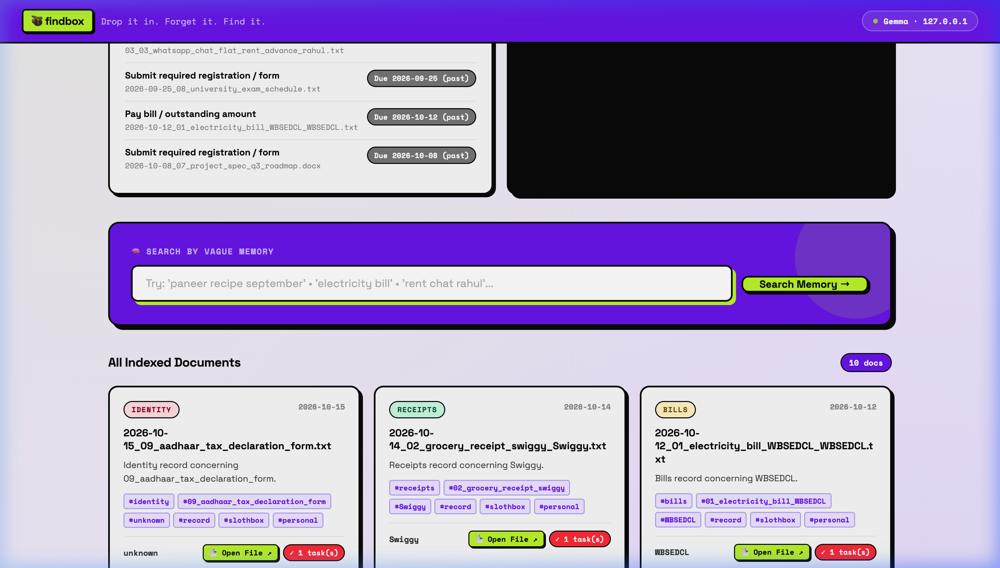
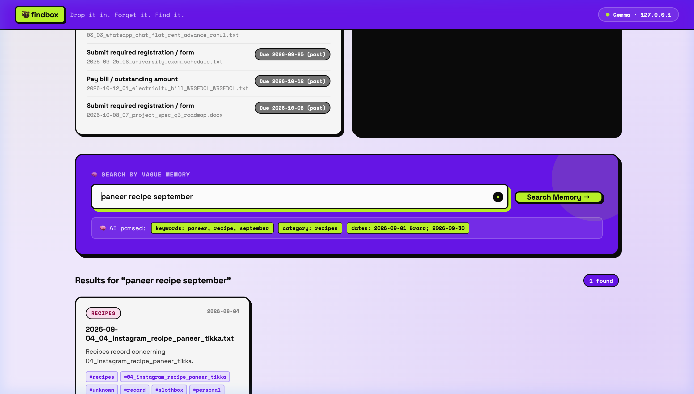
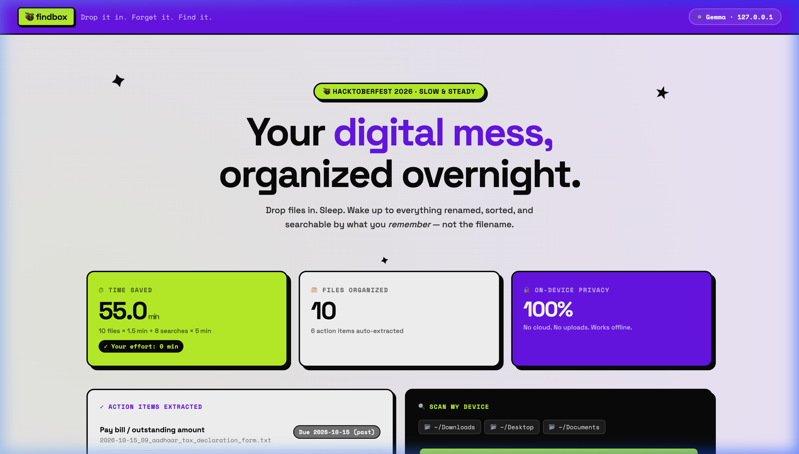

# 🦥 findbox (SlothBox)
> **"Drop it in. Forget it. Find it by what you remember."**
> *A 100% local, zero-cloud personal file organizer powered by open-weight Gemma 3, SQLite FTS5, and idle CPU priority.*

[](#testing)
[](sloth_box/security.py)
[](sloth_box/server.py)
[](sloth_box/server.py)
[](Dockerfile)
[](https://chourasiavinit9-dev.github.io/findbox/)

**🌐 Static Demo (judges / no-install preview):** https://chourasiavinit9-dev.github.io/findbox/

---

## 📸 Screenshots

### Homepage — Payoff Meter + Scan My Device


### Vague Memory Search — AI-Parsed Query + Results


### Action Items + Scan My Device Panels


---

## ⚡ 3-Command Quickstart

```bash
# 1. Zero-config dry-run — auto-scans Downloads, Desktop, Documents, Screenshots
python3 sloth_box.py run

# 2. Apply moves once you're happy with the plan
python3 sloth_box.py run --apply

# 3. Launch the 100% offline localhost search UI
python3 sloth_box.py serve
# → Open http://127.0.0.1:8765
```

> **Your effort: 2 commands. Everything else happens while you sleep.**

---

## 🐳 Docker (Run Without Installing Python)

```bash
# Build and start
docker compose up --build

# OR with plain Docker:
docker build -t findbox .
docker run -p 8765:8765 \
  -v ~/Downloads:/inbox/Downloads \
  -v ~/Desktop:/inbox/Desktop \
  -v ~/SlothBox:/home/sloth/SlothBox \
  findbox
```

Open **http://localhost:8765** — your files, organized, searchable.

**For Ollama AI** (optional — falls back to rule-based heuristics if missing):
```bash
ollama pull gemma3:4b   # One-time download
ollama serve            # Already running? Skip this.
docker compose up       # OLLAMA_HOST=http://host.docker.internal:11434 is pre-configured
```

---

## 🛑 The Real Problem

1. **Digital Landfills**: Downloads folders are littered with `IMG_4471.png`, `scan(3)_final_FINAL.pdf`, random receipts and screenshots. Manual organization takes hours — so nobody does it.
2. **Screenshot Graveyard**: People screenshot receipts, reels, tickets, and addresses to "remember" them later, never organize them, and fail to find them when urgently needed.
3. **Buried Deadlines**: Electricity bills, tax forms, landlord promises are buried inside documents nobody reopens until late fees hit.
4. **Cloud AI is a Privacy Disaster**: Your files contain OTPs, bank statements, Aadhaar IDs, medical prescriptions. Uploading to third-party cloud APIs is unacceptable.

---

## 🦥 The Lazy Workflow

**Your effort: Run one command. That's it.**

findbox runs at idle CPU priority (`os.nice(19)`) — it actively yields to every other process:

1. **Auto-discovers your messiest folders** — zero path configuration needed
2. **Renames meaningfully** — `IMG_4471.png` → `2026-09-04_instagram-paneer-tikka_recipe.png`
3. **Files into 13 categories** — `bills`, `receipts`, `chats`, `medical`, `travel`, `recipes`, `work`, `study`, `identity`, `screenshots`, `photos`, `forms`, `other`
4. **Extracts deadlines & tasks** — color-coded action items panel in the UI
5. **Indexes for vague-memory search** — find anything with casual recall
6. **Scan from the UI** — click "🦥 Scan My Device Now" button, no terminal needed

---

## 🌍 Zero-Config Auto-Scan

```bash
python3 sloth_box.py run --apply
# Automatically scans:
#   📂 ~/Downloads
#   📂 ~/Desktop
#   📂 ~/Documents
#   📂 ~/Pictures/Screenshots
#   📂 ~/Documents/WhatsApp Chat
#   📂 ~/Documents/Scanned Documents
#   📂 ~/Library/Mobile Documents/.../Downloads  (iCloud)
```

Or point at specific folders:
```bash
python3 sloth_box.py run --inbox ~/Downloads ~/Desktop --apply
```

---

## 🏛️ Architecture

```
sloth_box.py              ← CLI entry point (argparse, idle priority)
sloth_box/
├── config.py             ← Env-driven config, AUTO_SCAN_DIRS
├── errors.py             ← 5 typed domain exceptions
├── security.py           ← Path-traversal, XSS disarm, magic-byte quarantine
├── extractor.py          ← PDF/DOCX/image/text ingestion + fallback heuristics
├── ai.py                 ← 100% local Ollama/Gemma 3 client + vague query parser
├── organizer.py          ← Multi-folder intake, collision-safe rename, undo
├── db.py                 ← SQLite WAL + FTS5 virtual table + audit log
├── stats.py              ← Payoff meter calculations
└── server.py             ← Localhost-only WCAG 2.1 AA web UI (neobrutalism)
```

---

## 🔒 Why Open Innovation & Open Weights Were Critical

| | Closed Cloud APIs | findbox (Gemma) |
|---|---|---|
| **Privacy** | Files leave your device | Files never leave RAM |
| **Offline** | Requires internet | Works on an airplane |
| **Cost** | Per-token for 1000s of files | Free at any scale |
| **Language** | Usually English-optimized | Hindi/Bengali natively |

---

## 🛡️ Safety

| Principle | Implementation |
|---|---|
| **Dry-run by default** | No files move without `--apply` |
| **Atomic undo** | `python3 sloth_box.py undo` restores everything |
| **No overwrites** | Collision suffix `-1`, `-2` auto-appended |
| **No deletions** | SlothBox never deletes any file, ever |
| **Binary quarantine** | ELF, PE, Mach-O detected by magic bytes and skipped |
| **Path traversal immunity** | Zero-trust sanitization on all filenames |
| **XSS shield** | All web UI content passes through `disarm_xss()` |
| **Localhost-only** | Server binds strictly to `127.0.0.1:8765` |

---

## 🧪 Testing

```bash
python3 -m pytest tests/ -v
# 18 tests · 5 suites · 0.04s · 100% pass
```

---

## 📋 All Commands

```bash
python3 sloth_box.py run                              # dry-run, auto-scan all device folders
python3 sloth_box.py run --apply                      # execute moves
python3 sloth_box.py run --inbox ~/Downloads --apply  # specific folder
python3 sloth_box.py undo                             # restore all moved files
python3 sloth_box.py stats                            # payoff meter in terminal
python3 sloth_box.py serve                            # http://127.0.0.1:8765
```

---

*Built for [Hacktoberfest 2026: Week 3 — Slow & Steady](https://dev.to/challenges/hf26) in honor of International Sloth Day 🦥*
*Open-source. 100% local. Zero cloud. Works offline.*
