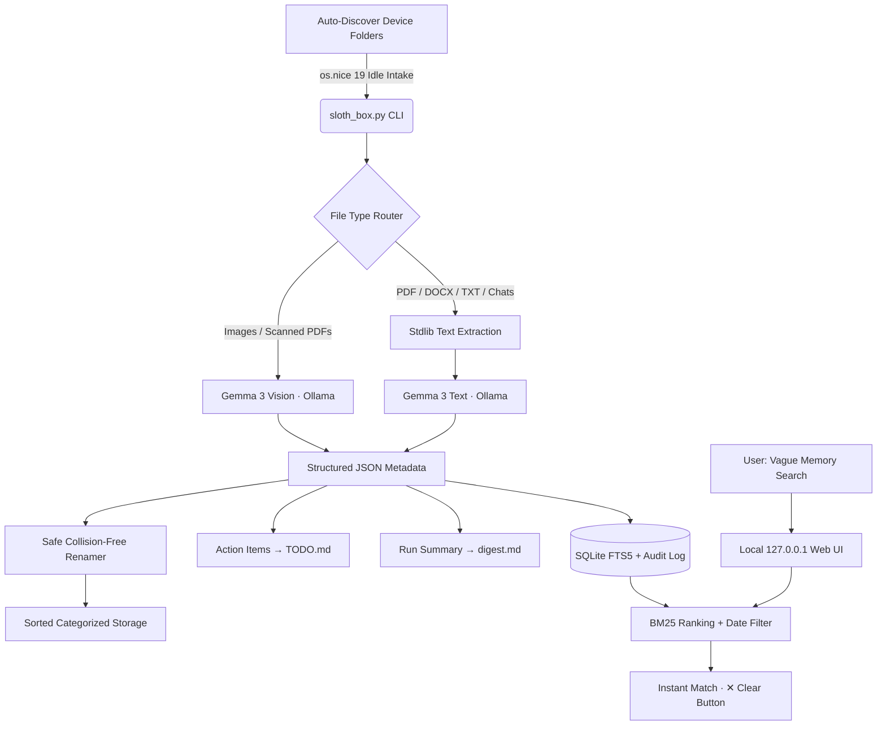

# 🦥 findbox (SlothBox)
> **"Drop it in. Forget it. Find it by what you remember."**
> *A 100% local, zero-cloud personal file organizer powered by open-weight Gemma 3, SQLite FTS5, and idle CPU priority. Built for Hacktoberfest 2026: Slow and Steady (International Sloth Day).*

[](#testing)
[](sloth_box/security.py)
[](sloth_box/server.py)
[](sloth_box/server.py)

---

## ⚡ 3-Command Quickstart

```bash
# 1. Zero-config dry-run — auto-scans Downloads, Desktop, Documents, Screenshots
python3 sloth_box.py run

# 2. Apply moves once you're happy with the plan
python3 sloth_box.py run --apply

# 3. Launch the 100% offline localhost search UI
python3 sloth_box.py serve
# → Open http://127.0.0.1:8765
```

> **Your effort: 2 commands. Everything else happens while you sleep.**

---

## 🛑 The Real Problem

1. **Digital Landfills**: Downloads folders are littered with `IMG_4471.png`, `scan(3)_final_FINAL.pdf`, random receipts, forms, and screenshots. Manual organization takes hours — so nobody does it.
2. **Screenshot Graveyard**: People screenshot receipts, reels, tickets, chats, and addresses to "remember" them later, never organize them, and fail to find them when urgently needed.
3. **Buried Deadlines**: Electricity bills, tax deadlines, tuition payments, and landlord promises are buried inside documents nobody reopens until late fees hit.
4. **Cloud AI is a Privacy Disaster**: Your files contain OTPs, bank statements, Aadhaar/SSN IDs, medical prescriptions, and private chat histories. Uploading to third-party cloud APIs is unacceptable.

---

## 🦥 The Lazy Workflow

**Your effort: Run one command. That's it.**

findbox runs at idle CPU priority (`os.nice(19)`), analyzing your files quietly in the background:

1. **Auto-discovers your messiest folders** — `~/Downloads`, `~/Desktop`, `~/Documents`, `~/Pictures/Screenshots`, WhatsApp exports, iCloud Drive — **zero path configuration needed**.
2. **Renames meaningfully** — `IMG_4471.png` → `2026-09-04_instagram-paneer-tikka_recipe.png`
3. **Files into standard categories** — `bills`, `receipts`, `chats`, `medical`, `travel`, `recipes`, `work`, `study`, `identity`, `screenshots`, `photos`, `forms`
4. **Extracts deadlines & tasks** — consolidates action items into `TODO.md` with a **"Due Soon"** section (< 7 days)
5. **Writes a "While You Did Nothing" digest** — logs everything that moved and flags items needing review in `digest.md`
6. **Indexes for vague-memory search** — find anything with casual recall: *"that paneer recipe from early September"*, *"rent chat with Rahul"*, *"WBSEDCL electricity bill"*

---

## 🌍 Zero-Config Auto-Scan

The killer feature: **no path needed**. SlothBox auto-discovers every common "digital landfill" on your device:

```bash
python3 sloth_box.py run --apply
# Automatically scans:
#   📂 ~/Downloads
#   📂 ~/Desktop
#   📂 ~/Documents
#   📂 ~/Pictures/Screenshots
#   📂 ~/Documents/WhatsApp Chat
#   📂 ~/Documents/Scanned Documents
#   📂 ~/Library/Mobile Documents/.../Downloads  (iCloud)
```

You can also point it at specific folders:

```bash
# Multiple explicit folders
python3 sloth_box.py run --inbox ~/Downloads ~/Desktop ~/Documents/Scans --apply

# A specific project folder
python3 sloth_box.py run --inbox ~/Documents/Tax2026 --apply
```

---

## 🏛️ System Architecture



### Modular Package Structure

```
sloth_box.py              ← CLI entry point (argparse, idle priority)
sloth_box/
├── config.py             ← Env-driven config, AUTO_SCAN_DIRS, constants
├── errors.py             ← Domain exception hierarchy (5 typed errors)
├── security.py           ← Path-traversal, XSS disarm, magic-byte quarantine, LRU cache
├── extractor.py          ← PDF/DOCX/image/text ingestion + fallback heuristics
├── ai.py                 ← 100% local Ollama/Gemma 3 client + vague query parser
├── organizer.py          ← Multi-folder intake, collision-safe rename, undo, search
├── db.py                 ← SQLite WAL + FTS5 virtual table + audit log
├── stats.py              ← Payoff meter calculations
└── server.py             ← Localhost-only WCAG 2.1 AA web UI (neobrutalism design)
```

---

## ⏱️ The Payoff Meter: Quantifying Laziness

$$\text{Minutes Saved} = (\text{Files Indexed} \times 1.5) + (\text{Searches Avoided} \times 5.0)$$

- **1.5 min / file**: Time to open, read, identify date, formulate a name, create folder hierarchy, and move the file manually
- **5.0 min / search**: Time spent fruitlessly searching through desktop clutter, galleries, and chat exports for that one thing
- **Your Effort: 0 minutes** (100% laziness — os.nice(19))

---

## 🔒 Why Open Innovation & Open Weights Were Critical

| | Closed Cloud APIs | findbox (Open-Weight Gemma) |
|---|---|---|
| **Privacy** | Your files leave your device | Files never leave RAM |
| **Offline** | Requires internet | Works on an airplane |
| **Cost** | Per-token billing for 1000s of files | Free at any scale |
| **Language** | Usually English-optimized | Gemma handles Hindi/Bengali transliterations natively |

Gemma natively understands multilingual context — queries like *"kharcha", "rent advance", "paneer tikka", "WBSEDCL", "Aadhaar"* all work without translation.

---

## 🛡️ Safety & Non-Destructive Principles

| Principle | Implementation |
|---|---|
| **Dry-run by default** | No files move without explicit `--apply` flag |
| **Atomic undo** | `python3 sloth_box.py undo` restores everything instantly |
| **No overwrites** | Collision suffix (`-1`, `-2`) auto-appended if target exists |
| **No deletions** | SlothBox never deletes any file, ever |
| **Skip, not crash** | Unreadable files are skipped with a warning, logged |
| **Binary quarantine** | ELF, PE, Mach-O, shell scripts detected by magic bytes and skipped |
| **Path traversal immunity** | Zero-trust sanitization on all filenames and paths |
| **XSS shield** | All web UI content passes through `disarm_xss()` |
| **Localhost-only** | HTTP server binds strictly to `127.0.0.1:8765` |

---

## 🧪 Testing

```bash
python3 -m pytest tests/ -v
# OR
python3 -m unittest discover tests -v
```

```
18 tests · 5 suites · 0.043s · 100% pass
────────────────────────────────────────
test_lru_cache_retrieval_and_latency      PASS
test_lru_eviction                         PASS
test_corrupted_file_resilience            PASS
test_docx_extraction                      PASS
test_sha256_computation                   PASS
test_bm25_and_date_filtering              PASS
test_fts5_query_escaping                  PASS
test_executable_magic_bytes_quarantine    PASS
test_fnv1a32_hashing                      PASS
test_path_traversal_sanitization          PASS
test_target_path_enforcement              PASS
test_xss_disarming                        PASS
test_heuristics_categorization            PASS
test_safe_moves_and_undo                  PASS
test_stats_payoff                         PASS
test_payoff_formula_constants             PASS
test_payoff_scaling                       PASS
test_zero_effort_invariant                PASS
```

---

## 📋 All Commands

```bash
# Intake & organize
python3 sloth_box.py run                          # dry-run, auto-scan all device folders
python3 sloth_box.py run --apply                  # execute moves
python3 sloth_box.py run --inbox ~/Downloads --apply  # specific folder
python3 sloth_box.py run --inbox ~/Downloads ~/Desktop --apply  # multiple folders

# Undo
python3 sloth_box.py undo                         # restore all moved files to original locations

# Stats
python3 sloth_box.py stats                        # Payoff meter in terminal

# Web UI
python3 sloth_box.py serve                        # http://127.0.0.1:8765
python3 sloth_box.py serve --port 9000            # custom port
```

---

## 🚀 Future Roadmap

- 📱 **Mobile Camera-Roll Sync**: Auto-watch a synced folder from iCloud Photos or Syncthing
- 💬 **"Ask This Document"**: Chat directly with individual indexed files using local Gemma
- 🧹 **Duplicate & Blurry Photo Janitor**: Automatically group near-identical screenshots
- 🎙️ **Voice Memo Summaries**: Transcribe spoken voice notes locally using open-weight Whisper
- ⏰ **Launchd / Cron Mode**: Run silently every night at 2 AM without any user interaction

---

*Built for [Hacktoberfest 2026: Week 3 — Slow & Steady](https://dev.to/challenges/hf26) in honor of International Sloth Day 🦥*
*Open-source. 100% local. Zero cloud. Works offline.*
